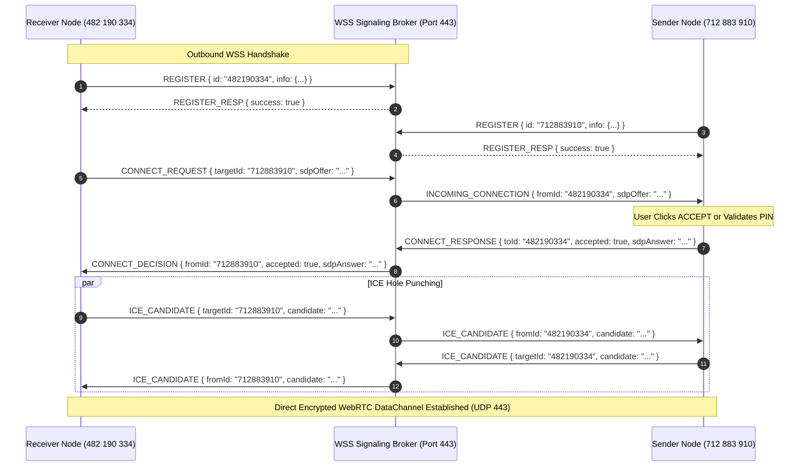

# USB Master Pro — API & Signaling Protocol Specification

**Document Version**: 1.0.0  
**Classification**: IPC & Network Signaling Specification  
**Local IPC Base URL**: `http://127.0.0.1:19842`  
**Signaling Protocol**: Outbound WSS / JSON Schema  

---

## 1. Local Engine IPC REST API

The local Rust daemon (`USBMasterDaemon.exe` / `USBMasterPro.exe`) exposes an internal REST API on loopback interface `127.0.0.1:19842`. This interface serves the embedded single-binary WebUI and processes control commands from the local desktop application.

```
+----------------------------------------------------------------------------------------------------+
|                               LOCAL REST API ENDPOINTS SUMMARY                                     |
+----------------------------------------------------------------------------------------------------+
|  GET   /api/identity   -> Retrieves local 9-digit AnyUSB ID, hardware hash, and rolling PIN        |
|  GET   /api/devices    -> Enumerates connected physical hardware & mounted remote virtual devices  |
|  POST  /api/forward    -> Toggles sharing state for a specified physical USB device               |
|  POST  /api/connect    -> Initiates a P2P connection to a remote 9-digit AnyUSB ID                 |
|  POST  /api/respond    -> Accepts or rejects an incoming remote connection authorization prompt    |
|  GET   /api/status     -> Returns real-time daemon telemetry, throughput, and RD Service latency   |
|  GET   /api/events     -> Real-time WebSocket event stream for reactive UI state updates           |
+----------------------------------------------------------------------------------------------------+
```

---

### 1.1 `GET /api/identity`
Retrieves the persistent, cryptographically derived identity of the local computer.

#### Response:
- **Status**: `200 OK`
- **Content-Type**: `application/json`

```json
{
  "raw_id": 482190334,
  "formatted_id": "482 190 334",
  "default_pin": "821 490",
  "hardware_hash": "a4f89d816c4f74d0932e6a9821804d9d15024b423714bfa4d82260ff8719bc01"
}
```

---

### 1.2 `GET /api/devices`
Scans and enumerates all connected physical USB hardware on the host computer, matching them against the heuristic hardware database, as well as any remote virtual devices currently mounted from peer machines.

#### Response:
- **Status**: `200 OK`
- **Content-Type**: `application/json`

```json
[
  {
    "id": "USB\\VID_27D0&PID_0041\\1048291",
    "name": "Mantra MFS100 Optical Fingerprint Scanner",
    "vendor": "Mantra Softech",
    "model": "MFS100 Optical Fingerprint Scanner",
    "category": "FingerprintScanner",
    "icon": "🪪",
    "vid": 10192,
    "pid": 65,
    "is_shared": true,
    "is_mounted": false,
    "flags": 1,
    "remote_peer_id": null
  },
  {
    "id": "USB\\VID_046D&PID_082D\\58291A",
    "name": "Logitech HD Pro Webcam C920",
    "vendor": "Logitech",
    "model": "HD Pro Webcam C920",
    "category": "Webcam",
    "icon": "📷",
    "vid": 1133,
    "pid": 2093,
    "is_shared": false,
    "is_mounted": false,
    "flags": 2,
    "remote_peer_id": null
  }
]
```

---

### 1.3 `POST /api/forward`
Attaches or detaches the KMDF upper filter driver (`anyusb_filter.sys`) to start or stop sharing a physical USB peripheral.

#### Request Body:
```json
{
  "device_id": "USB\\VID_27D0&PID_0041\\1048291",
  "share": true,
  "force": false
}
```

#### Response:
- **Status**: `200 OK`
```json
{
  "success": true,
  "device_id": "USB\\VID_27D0&PID_0041\\1048291",
  "is_shared": true,
  "message": "Device sharing activated successfully"
}
```

---

### 1.4 `POST /api/connect`
Initiates a peer-to-peer WebRTC connection request toward a remote 9-digit AnyUSB ID.

#### Request Body:
```json
{
  "target_id": "712 883 910",
  "pin": "821 490",
  "device_id": "USB\\VID_27D0&PID_0041\\1048291"
}
```

#### Response:
- **Status**: `200 OK`
```json
{
  "success": true,
  "target_id": "712883910",
  "status": "CONNECTING",
  "message": "Connection request dispatched to signaling broker"
}
```

---

### 1.5 `POST /api/respond`
Submits the local user's decision (Accept or Reject) for an incoming connection request modal.

#### Request Body:
```json
{
  "from_id": "288512309",
  "accepted": true,
  "reason": "User authorized connection"
}
```

#### Response:
- **Status**: `200 OK`
```json
{
  "success": true,
  "from_id": "288512309",
  "status": "ACCEPTED"
}
```

---

### 1.6 `GET /api/status`
Returns real-time performance metrics, connection state, and live telemetry.

#### Response:
- **Status**: `200 OK`
```json
{
  "status": "Online",
  "uptime_secs": 3842,
  "broker_connected": true,
  "broker_url": "wss://broker.bhartx.in/v1",
  "identity": {
    "raw_id": 482190334,
    "formatted_id": "482 190 334",
    "default_pin": "821 490",
    "hardware_hash": "a4f89d816c4f74d0932e6a9821804d9d15024b423714bfa4d82260ff8719bc01"
  },
  "local_device_count": 4,
  "remote_device_count": 1,
  "turbo_urb_throughput_mb_s": 10298.4,
  "rd_service_latency_ms": 0.049
}
```

---

## 2. WebSocket Signaling Broker Protocol

The signaling broker operates over standard outbound `WSS 443` (or development port `8443`). It routes connection requests, SDP session descriptions, and ICE candidates between nodes identified by their 9-digit AnyUSB IDs.



### 2.1 Message Schemas

#### A. `REGISTER` (Client $\to$ Broker)
Registers a node on the rendezvous broker upon application launch.
```json
{
  "type": "REGISTER",
  "id": "482190334",
  "info": {
    "hostname": "WORKSTATION-01",
    "os": "windows",
    "version": "1.0.0",
    "devices": []
  }
}
```

#### B. `REGISTER_RESP` (Broker $\to$ Client)
```json
{
  "type": "REGISTER_RESP",
  "success": true,
  "id": "482190334",
  "serverTime": 1729864200000
}
```

#### C. `CONNECT_REQUEST` (Initiator $\to$ Broker)
```json
{
  "type": "CONNECT_REQUEST",
  "fromId": "482190334",
  "targetId": "712883910",
  "deviceId": "USB\\VID_27D0&PID_0041\\1048291",
  "deviceName": "Mantra MFS100 Optical Fingerprint Scanner",
  "pin": "821490",
  "sdpOffer": "v=0\r\no=- 482190334 2 IN IP4 127.0.0.1..."
}
```

#### D. `INCOMING_CONNECTION` (Broker $\to$ Target)
```json
{
  "type": "INCOMING_CONNECTION",
  "fromId": "482190334",
  "fromHostname": "WORKSTATION-01",
  "deviceId": "USB\\VID_27D0&PID_0041\\1048291",
  "deviceName": "Mantra MFS100 Optical Fingerprint Scanner",
  "pin": "821490",
  "sdpOffer": "v=0\r\no=- 482190334 2 IN IP4 127.0.0.1..."
}
```

#### E. `CONNECT_RESPONSE` (Target $\to$ Broker)
```json
{
  "type": "CONNECT_RESPONSE",
  "toId": "482190334",
  "accepted": true,
  "reason": "Authorized by user",
  "sdpAnswer": "v=0\r\no=- 712883910 2 IN IP4 127.0.0.1..."
}
```

#### F. `CONNECT_DECISION` (Broker $\to$ Initiator)
```json
{
  "type": "CONNECT_DECISION",
  "fromId": "712883910",
  "accepted": true,
  "reason": "Authorized by user",
  "sdpAnswer": "v=0\r\no=- 712883910 2 IN IP4 127.0.0.1..."
}
```

#### G. `ICE_CANDIDATE` (Peer $\leftrightarrow$ Broker $\leftrightarrow$ Peer)
```json
{
  "type": "ICE_CANDIDATE",
  "targetId": "712883910",
  "candidate": "candidate:842163049 1 udp 16777295 203.0.113.195 54320 typ srflx..."
}
```

#### H. `PING` / `PONG` (Keep-Alive)
```json
{ "type": "PING" }
```
```json
{ "type": "PONG", "timestamp": 1729864205120 }
```
