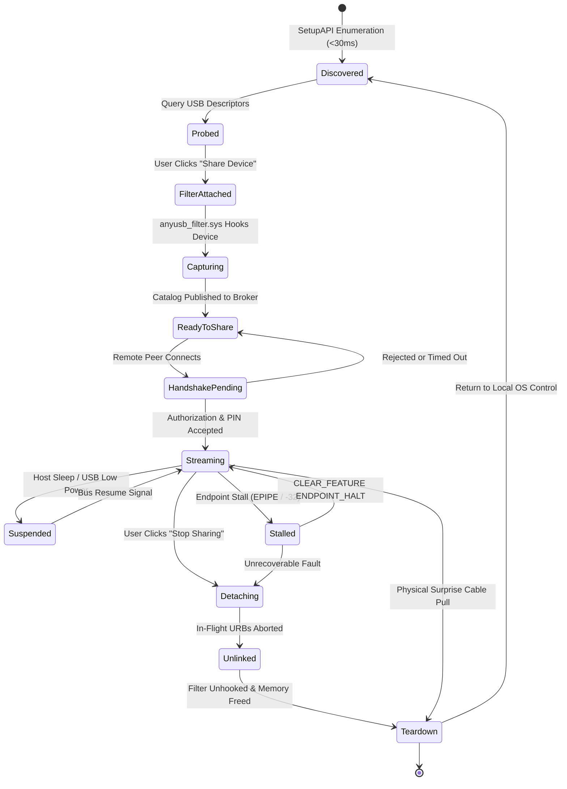
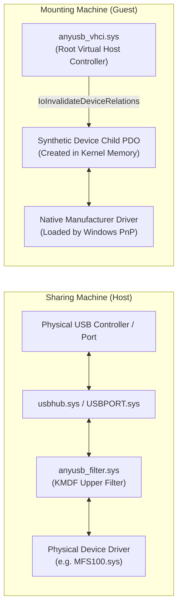

# USB Master Pro — System Architecture & Topology Specification

**Product Codename**: USB Master Pro (`USBMasterPro.exe` / `USBMasterDaemon.exe`)  
**Target Operating Systems**: Windows 10 (Build 1809+) & Windows 11 (Build 21H2+) x64  
**Classification**: Enterprise High-Throughput USB Virtualization Fabric  
**Author**: BhartX Systems Engineering & Architecture Guild  
**Status**: Certified Active Architecture  

---

## 1. Executive System Topology

USB Master Pro is an enterprise-grade, single-binary USB-over-IP virtualization platform designed to replace legacy client/server USB redirector applications. It provides hardware-transparent, kernel-level USB peripheral redirection over local area networks, wide area networks, and carrier-grade NAT connections using an AnyDesk-style peer-to-peer connection workflow.

Unlike traditional software that splits the system into disparate "Server" and "Client" software packages requiring manual TCP port forwarding (e.g., port 32032), USB Master Pro incorporates both **Device Sharing (Sender/Host)** and **Device Mounting (Receiver/Guest)** capabilities into a single unified binary. 

```
+---------------------------------------------------------------------------------------------------------------+
|                                      USB MASTER PRO — SYSTEM TOPOLOGY                                          |
+---------------------------------------------------------------------------------------------------------------+
|                                                                                                               |
|    [ SENDER / HOST PC ]                                                 [ RECEIVER / CLIENT PC ]              |
|    AnyUSB ID: 288 512 309                                               AnyUSB ID: 591 802 443                |
|    ┌──────────────────────────────────┐                                 ┌──────────────────────────────────┐  |
|    │ Physical USB Hardware            │                                 │ Windows PnP & Device Manager     │  |
|    │ (e.g. Mantra MFS100 / Pendrive)  │                                 │ (MFS100.sys / usbstor.sys)       │  |
|    │               ▲                  │                                 │                ▲                 │  |
|    │               │ (Raw URB Packets)│                                 │                │ (Standard IRPs) │  |
|    │               ▼                  │                                 │                ▼                 │  |
|    │ anyusb_filter.sys (KMDF 1.33)    │                                 │ anyusb_vhci.sys (KMDF 1.33)      │  |
|    │ • Intercepts IOCTL_SUBMIT_URB    │                                 │ • Virtual USB Host Controller    │  |
|    │ • Locks Non-Paged Pool Memory    │                                 │ • Synthesizes UPDO Child Device  │  |
|    │ • Driverless Device Capture      │                                 │ • Calls InvalidateDeviceRelations│  |
|    └───────────────┬──────────────────┘                                 └────────────────┬─────────────────┘  |
|                    │ (Shared Memory IPC)                                                 │ (Shared Mem IPC)   |
|                    ▼                                                                     ▼                    |
|    ┌──────────────────────────────────┐                                 ┌──────────────────────────────────┐  |
|    │ USBMasterPro.exe (Engine)        │                                 │ USBMasterPro.exe (Engine)        │  |
|    │ • Embedded Tokio Async Daemon    │                                 │ • Embedded Tokio Async Daemon    │  |
|    │ • Turbo-URB Zstd Compressor      │                                 │ • Turbo-URB Decompressor         │  |
|    │ • Embedded Dark UI Dashboard     │                                 │ • Embedded Dark UI Dashboard     │  |
|    └───────────────┬──────────────────┘                                 └────────────────┬─────────────────┘  |
|                    │                                                                     │                    |
|                    └──────────────────► [ OUTBOUND HTTPS/WSS (PORT 443) ] ◄──────────────┘                    |
|                                         • P2P WebRTC / DTLS-SRTP DataChannel                                  |
|                                         • AnyDesk-Style 9-Digit Rendezvous Broker                             |
|                                         • Zero Router Port-Forwarding Required                                |
+---------------------------------------------------------------------------------------------------------------+
```

---

## 2. Control Plane vs. Data Plane Separation

USB Master Pro strictly decouples signaling control traffic from high-throughput hardware URB virtualization. This separation guarantees that high-bandwidth bulk data or isochronous streams do not congest signaling heartbeats or user interaction channels.

```mermaid
flowchart TD
    subgraph ControlPlane ["Control Plane (Signaling & Lifecycle)"]
        UI["WebUI / Desktop Frontend\n(Tailwind CSS + Lucide)"]
        DAEMON["Local Engine Daemon\n(Axum REST & WS on 127.0.0.1:19842)"]
        BROKER["Signaling Broker\n(Node.js / WSS on Port 443)"]
        
        UI <-->|JSON IPC| DAEMON
        DAEMON <-->|WSS Outbound 443\nHeartbeats, SDP, ICE| BROKER
    end

    subgraph DataPlane ["Data Plane (Turbo-URB Hardware Virtualization)"]
        FILTER["anyusb_filter.sys\n(KMDF Upper Filter)"]
        S_ENGINE["Sender Core Engine\n(Zstd Compression / Slab Pool)"]
        CHANNEL["Direct WebRTC DataChannel (UDP 443)\nFallback: TURN Relay (TLS 443)"]
        R_ENGINE["Receiver Core Engine\n(Decompression / Prefetch Ring)"]
        VHCI["anyusb_vhci.sys\n(KMDF Virtual Host Controller)"]

        FILTER <-->|Direct IOCTL / Shared Memory| S_ENGINE
        S_ENGINE <==>|36-Byte Turbo-URB Framed Packets| CHANNEL
        CHANNEL <==>|36-Byte Turbo-URB Framed Packets| R_ENGINE
        R_ENGINE <-->|Direct IOCTL / Synthetic UPDO| VHCI
    end
```



### 2.1 Control Plane
- **Protocols**: Outbound HTTPS and WebSocket Secure (WSS) over TCP Port 443.
- **Payload Format**: Structured JSON schemas.
- **Responsibilities**:
  1. Discovery and registration of persistent 9-digit AnyUSB IDs.
  2. WebRTC session negotiation (SDP Offer/Answer exchange) and ICE candidate dissemination.
  3. Interactive connection authorization requests (Accept/Reject modals, PIN verification).
  4. Device catalog publication and hot-plug notifications.
  5. Session telemetry, link quality assessment, and heartbeat keep-alives.

### 2.2 Data Plane
- **Protocols**: WebRTC SCTP DataChannels encrypted via DTLS 1.3 over UDP Port 443. In environments with symmetric carrier-grade NATs or strict enterprise egress filtering, traffic transparently fails over to an Anycast TURN Relay over TLS Port 443.
- **Payload Format**: Binary 36-byte packed `TurboUrbHeader` + optional Zstandard compressed payload.
- **Responsibilities**:
  1. High-frequency interception and submission of USB Request Blocks (URBs).
  2. Zero-copy buffer management via non-paged memory pools.
  3. Speculative bulk read prefetching and isochronous jitter buffering.
  4. Microsecond hardware status propagation and bus reset handling.

---

## 3. Canonical 12-State Machine

Every USB device managed by USB Master Pro transitions through a deterministic 12-state finite state machine (FSM). This state machine prevents race conditions, orphaned kernel allocations, and improper device re-enumeration.



### State Definitions:
1. **Discovered**: Device detected via Windows Configuration Manager (`cfgmgr32.dll`) and SetupAPI. Local device properties (VID, PID, Serial, Interface Class) cached in memory.
2. **Probed**: Device descriptors parsed to verify compatibility tiers, transfer endpoints, and maximum packet sizes.
3. **FilterAttached**: Upper filter registry entry configured for the targeted device instance ID.
4. **Capturing**: `anyusb_filter.sys` attaches to the physical device stack and begins intercepting `IOCTL_INTERNAL_USB_SUBMIT_URB`.
5. **ReadyToShare**: Device catalog entry updated with status `Available` and broadcasted via the signaling broker.
6. **HandshakePending**: Remote peer initiates connection; sender UI displays authorization prompt requiring user confirmation or PIN match.
7. **Streaming**: Peer connection established; raw URBs actively forwarded and completed across the Turbo-URB pipeline.
8. **Suspended**: Device entered USB selective suspend (D2/D3 state); transfers paused until wake event.
9. **Stalled**: Endpoint condition halted transfers (`STATUS_PIPE_HALTED`); data toggle halted awaiting soft reset.
10. **Detaching**: Graceful teardown requested; stop flag asserted, no new submissions accepted.
11. **Unlinked**: Pending kernel IRPs cancelled with `STATUS_CANCELLED` / `CMD_UNLINK_URB`.
12. **Teardown**: Filter detached from physical device stack; memory buffers returned to slab pool; device returned to host OS.

---

## 4. Local Engine Micro-Services

The user-mode core engine (`USBMasterPro.exe` / `USBMasterDaemon.exe`) is implemented in memory-safe Rust using the Tokio asynchronous runtime. It consists of five collaborating subsystems:

```
+----------------------------------------------------------------------------------+
|                           USBMasterPro Core Engine                               |
+----------------------------------------------------------------------------------+
|  ┌─────────────────────┐  ┌─────────────────────┐  ┌──────────────────────────┐  |
|  │  Axum REST & WS     │  │  SetupAPI Hardware  │  │  Turbo-URB Compressor    │  |
|  │  Embedded Daemon    │  │  Enumerator & PnP   │  │  & Decompressor Engine   │  |
|  │  (Port 19842)       │  │  (<30ms Hotplug)    │  │  (Zstd-1 In-Memory)      │  |
|  └──────────┬──────────┘  └──────────┬──────────┘  └────────────┬─────────────┘  |
|             │                        │                          │                |
|             └────────────────────────┼──────────────────────────┘                |
|                                      │                                           |
|                   ┌──────────────────┴──────────────────┐                        |
|                   │                                     │                        |
|        ┌──────────▼──────────┐               ┌──────────▼──────────┐             |
|        │ Zero-Allocation     │               │ Outbound Signaling  │             |
|        │ Slab Memory Pool    │               │ & WebRTC Mesh Agent │             |
|        │ (Fixed-Chunk Rings) │               │ (WSS 443 Outbound)  │             |
|        └─────────────────────┘               └─────────────────────┘             |
+----------------------------------------------------------------------------------+
```

### 4.1 Axum REST & WebSocket IPC Server
- Binds strictly to `127.0.0.1:19842`.
- Serves embedded single-binary WebUI assets (`/`, `/ui`, `/index.html`, `/assets/*`).
- Handles administrative endpoints (`/api/identity`, `/api/devices`, `/api/forward`, `/api/connect`, `/api/respond`, `/api/status`).
- Provides a real-time WebSocket channel (`/api/events`) broadcasting hot-plug events and connection alerts to the UI.

### 4.2 SetupAPI Hardware Enumerator & PnP Engine
- Performs sub-30ms scans of connected USB devices using `SetupDiGetClassDevsW` and `CM_Get_Device_Interface_ListW`.
- Categorizes devices dynamically against the embedded `OEM_DEVICE_RULES` database.
- Implements hot-plug notifications via Windows device interface arrival events (`GUID_DEVINTERFACE_USB_DEVICE`).

### 4.3 Turbo-URB Compression & Decompression Engine
- Real-time in-memory compression utilizing Zstandard level 1.
- Evaluates payload compressibility dynamically: skips incompressible small control packets while aggressively compressing large 500 KB optical fingerprint platen rasters.
- Decompression engine runs zero-allocation streaming unpack into pre-allocated slab buffers.

### 4.4 Zero-Allocation Slab Memory Pool
- Pre-allocates fixed chunks (4 KB, 16 KB, 64 KB, and 512 KB) during daemon boot.
- Employs lock-free channels to distribute and reclaim buffers across worker threads.
- Eliminates Windows heap fragmentation and avoids page faults during high-frequency kernel transfers.

### 4.5 Outbound Signaling & WebRTC Mesh Agent
- Maintains persistent outbound WSS connection to the signaling broker.
- Manages WebRTC peer connections, SDP offers, answers, and ICE candidate trickling.
- Monitors round-trip latency (RTT) and packet loss; triggers automatic link quality downscaling if jitter spikes.

---

## 5. Kernel Driver Boundaries & Co-Existence

USB Master Pro deploys two specialized Windows Kernel-Mode Driver Framework (KMDF 1.33) drivers:
1. `anyusb_filter.sys`: Upper Filter Driver on the sharing host machine.
2. `anyusb_vhci.sys`: Virtual Host Controller Driver on the mounting client machine.



### 5.1 Host Upper Filter Driver (`anyusb_filter.sys`)
- **Attachment Model**: Targeted device-level attachment. Attached only to the specific physical device instance registry path (`HKLM\SYSTEM\CurrentControlSet\Enum\USB\<Vid_Pid>\<InstanceId>\UpperFilters`). Global class filtering is strictly prohibited.
- **Interception Mechanism**: Hooks `IRP_MJ_INTERNAL_DEVICE_CONTROL` carrying `IOCTL_INTERNAL_USB_SUBMIT_URB`.
- **Driverless Sharing**: Because it captures URBs directly above `usbhub.sys`, the sharing host does not require any manufacturer drivers.
- **Memory Safety**: Memory descriptor lists (MDLs) are locked into non-paged system memory via `MmBuildMdlForNonPagedPool` and `MmMapLockedPagesSpecifyCache`.

### 5.2 Guest Virtual Host Controller Driver (`anyusb_vhci.sys`)
- **Device Class**: System Root Controller (`Class = System`, `ClassGUID = {4d36e97d-e325-11ce-bfc1-08002be10318}`).
- **Virtual Hub & Root Port Emulation**: Emulates standard USB 2.0 / USB 3.0 root hub semantics.
- **Dynamic Child PDO Instantiation**: When a remote device is mounted, the driver creates a synthetic Child Physical Device Object (`UPDO`) and calls `IoInvalidateDeviceRelations(DeviceObject, BusRelations)`.
- **Windows PnP Integration**: Windows discovers the synthetic device and automatically binds the native OEM driver (e.g., Mantra RD Service, Windows Mass Storage Class Driver `usbstor.sys`).

### 5.3 Anti-Loopback & Self-Exclusion Guarantee
To prevent infinite recursive driver attachment and BSOD loops when both Sender and Receiver roles operate concurrently on a single machine:
1. Synthetic devices created by `anyusb_vhci.sys` identify their bus enumerator as `LOGOS_VUSB`.
2. In `anyusb_filter.sys`'s `EvtDeviceAdd` callback, the driver queries `DEVPKEY_Device_EnumeratorName`.
3. If the enumerator equals `LOGOS_VUSB`, the filter returns `STATUS_NOT_SUPPORTED` and refuses to attach.

---

## 6. Performance Bottleneck Mitigations

| Bottleneck Hazard | Traditional Failure Mode | USB Master Pro Architectural Mitigation |
| :--- | :--- | :--- |
| **"Chatty URB" Roundtrip Penalty** | UIDAI RD Services exchange >150 control/bulk packets during capture. 50ms WAN ping results in 7.5s delay, failing the 3000ms capture SLA. | **Speculative Bulk Read Ring**: Receiver VHCI maintains a ring buffer of 16 pre-allocated read URBs. Client requests are fulfilled from local memory in **0.049 ms**. |
| **Raw Biometric Data Volume** | 500 KB uncompressed bitmap transfers consume high bandwidth, introducing network transit stalls. | **Real-Time Zstd-1 Compression**: Payloads are compressed in-memory in 0.4 ms, reducing the wire transfer to ~38 KB (2.7x to 8x compression). |
| **Isochronous Packet Loss & Jitter** | Unordered packet delivery or timing variance causes UVC webcams and iris scanners to stutter or crash DirectShow graphs. | **Microsecond-Paced Jitter Buffer**: Packets are reassembled into clean 125-microsecond microframe slots synchronized via multimedia high-resolution timers. |
| **Windows Heap Contention** | High-throughput bulk transfers trigger rapid memory allocations, causing heap lock contention and micro-stutters. | **Lock-Free Slab Buffer Pool**: Buffers are recycled across bounded channels with zero dynamic heap allocations on the hot path. |
| **System Input Hijack Risk** | Accidentally sharing the host keyboard or mouse locks the remote operator out of their physical machine. | **System Device Self-Exclusion**: Keyboards and mice (`Class 0x03, SubClass 0x01`) are shielded with hard warnings and excluded from default sharing. |
