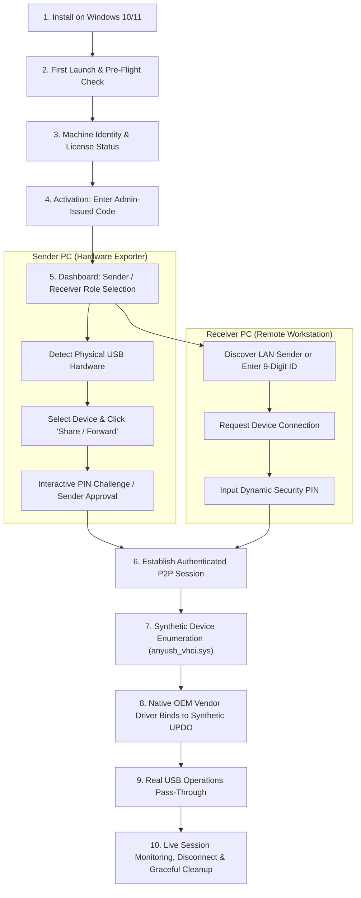
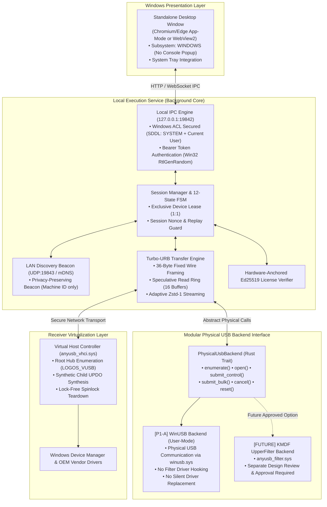
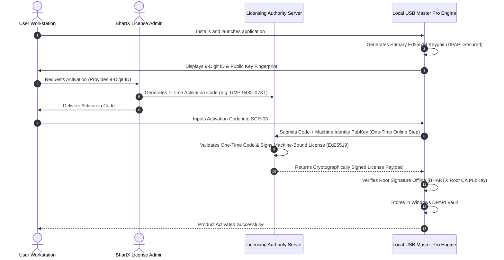
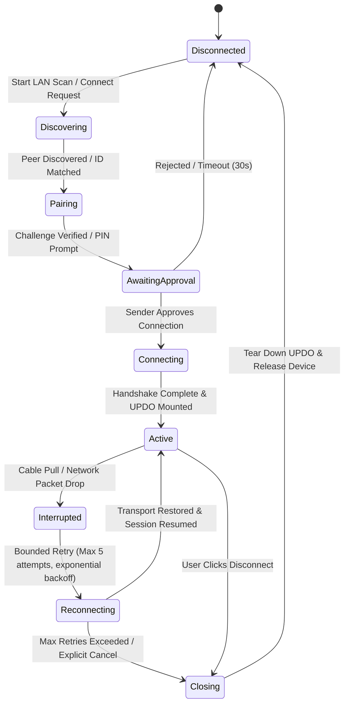

# ⚡ USB Master Pro — Complete Product & Engineering Blueprint

**Document ID:** `USBMP-MASTER-EXECUTION-2026-V1`  
**Revision:** v1.1.0-Strict (Engineering Baseline & Governance Edition)  
**Product:** USB Master Pro — Commercial USB Virtualization Platform  
**Company / Owner:** BhartX Ecosystems Pvt Ltd ([https://bhartx.in](https://bhartx.in))  
**Target Platform:** Windows 10 & Windows 11 (x64 / AMD64 Native)  
**Primary Market:** India-First (CSC, Banking Kiosks, Aadhaar Seva Kendra, Field Engineers, Enterprises)  
**Deployment Model:** Self-hosted endpoints, LAN-first direct P2P  
**License Model:** Admin-Controlled Model A (Machine-bound cryptographically signed license)  
**Architecture Status:** Active Specification & Engineering Standard  

---

## 📑 Table of Contents
1. [Product Vision vs. Engineering Reality](#1-product-vision-vs-engineering-reality)
2. [Complete User Journey & Screen Specifications](#2-complete-user-journey--screen-specifications)
3. [Full Product Feature Map & Capability Matrix](#3-full-product-feature-map--capability-matrix)
4. [Internal Engineering Architecture](#4-internal-engineering-architecture)
   - 4.1 [Native Windows Desktop UI (Zero Console, Standalone App Window)](#41-native-windows-desktop-ui)
   - 4.2 [Local Background Service & Windows ACL-Secured IPC](#42-local-background-service--windows-acl-secured-ipc)
   - 4.3 [Physical USB Backend Abstraction (P1-A WinUSB vs. Future Kernel Filter)](#43-physical-usb-backend-abstraction)
   - 4.4 [Virtual Host Controller Interface (VHCI Receiver)](#44-virtual-host-controller-interface-vhci-receiver)
   - 4.5 [Network Transport: LAN-First Discovery & P2P Engine](#45-network-transport-lan-first-discovery--p2p-engine)
5. [Machine Identity & Cryptographic Authentication](#5-machine-identity--cryptographic-authentication)
6. [Licensing & Admin-Controlled Model A](#6-licensing--admin-controlled-model-a)
7. [Security, Privacy & Threat Model](#7-security-privacy--threat-model)
8. [Reliability, Fault-Tolerance & Recovery Finite Automaton](#8-reliability-fault-tolerance--recovery-finite-automaton)
9. [Commercial Editions & Feature Tiers](#9-commercial-editions--feature-tiers)
10. [Engineering Milestones & Phased Roadmap](#10-engineering-milestones--phased-roadmap)
11. [Testing Blueprint & Hardware Validation Gates](#11-testing-blueprint--hardware-validation-gates)
12. [Master Execution Directive & Founder Approval Gates](#12-master-execution-directive--founder-approval-gates)

---

## 1. Product Vision vs. Engineering Reality

To prevent architectural drift and premature marketing claims, all statements in this document are strictly partitioned into five distinct categories:

| Horizon | Definition | Current Status in USB Master Pro |
| :--- | :--- | :--- |
| **Product Vision** | The ultimate target user experience, capabilities, and market positioning. | AnyDesk-style peer-to-peer USB redirection for Windows 10/11 with zero router configuration. |
| **Implemented Capabilities** | Features whose code exists in the repository, compiles, and passes automated CI tests. | KMDF VHCI driver (`anyusb_vhci.sys`), Turbo-URB framing, 133 automated unit/integration tests in CI, Axum loopback IPC, DPAPI entropy, Inno Setup script. |
| **Planned Capabilities** | Features designed and specified in this blueprint, scheduled for upcoming phases. | P1-A WinUSB user-mode physical bridge, UDP LAN discovery beacon, native window wrapper without terminal, Admin Model A activation portal. |
| **Verified Hardware Support** | Physical hardware devices validated through rigorous physical test matrices with documented test logs. | **NONE currently.** (Only synthetic in-memory loops and software simulated devices have passed automated tests in CI). |
| **Unverified Assumptions** | Performance figures, latency targets, and compatibility hypotheses requiring physical empirical validation. | UIDAI Aadhaar capture time < 1500 ms, LAN p95 round-trip latency < 50 ms, universal WinUSB device support without driver INF issues. |

### 1.1 Core Product Promises (Vision)
1. **Targeted USB Hardware Redirection**: Forward physical USB peripherals from a Sender PC to a Receiver PC such that native client software can operate the remote peripheral.
2. **Simple Pairing**: Human-readable 9-digit machine identifier (`XXX XXX XXX`), local LAN discovery, and dynamic PIN/Sender approval.
3. **LAN-First Architecture**: When PCs reside on the same Wi-Fi or subnet, USB data travels peer-to-peer over direct encrypted connections without requiring central cloud relays.
4. **Resilient Session Recovery**: Deterministic state machine handling cable unplug, network hiccups, laptop sleep, and auto-reconnection without crashing the OS.
5. **Admin-Controlled Licensing (Model A)**: Cryptographically signed, machine-bound licenses activated via one-time admin-generated codes.
6. **Defensive Kernel Stability**: Bounded buffers, dual-clamped lengths, and lock-free teardowns designed to avoid memory corruption and system bugchecks.

---

## 2. Complete User Journey & Screen Specifications

### 2.1 End-to-End User Flow
The commercial product journey remains preserved across all implementation phases:



### 2.2 Screen-by-Screen Specifications

| Screen ID | Screen Name | Key UI Elements & Controls | Operational Behavior |
| :--- | :--- | :--- | :--- |
| **SCR-01** | **Welcome & Setup** | Pre-flight compatibility check: Windows OS build, test-signing status, driver staging health, and firewall status. | Displayed on initial install or when kernel drivers are not yet running; guides user through dynamic setup. |
| **SCR-02** | **Account & Machine Identity** | Display 9-digit Machine ID, installation public key fingerprint, machine name, and license status pill. | Displays machine identity. Provides activation code entry modal when unlicensed. |
| **SCR-03** | **Activation Modal (Model A)**| One-time Activation Code input field, "Activate License" button, machine binding confirmation, offline verification status. | Redeems code against licensing authority; verifies Ed25519 root signature offline; writes signed token to DPAPI vault. |
| **SCR-04** | **Home Dashboard** | Dual-pane layout: "This Computer" (Sender ID + PIN) on left; "Connect to Remote" on right; live connection status pill (`🟢 Ready`, `🟡 LAN-Only`, `🔴 Offline`). | Central command interface. Clean, uncluttered AnyDesk-style design. Zero complex configuration. |
| **SCR-05** | **USB Devices Manager** | Connected physical device list: VID:PID, Manufacturer, Product Name, Device Class, Interface info, `SHARE` / `CLAIM` button. | Categorizes devices. Displays compatibility warning if device requires kernel filter or unsupported transfer type. |
| **SCR-06** | **Pairing & Approval Modal** | Sender approval dialog with 30-second timeout, requesting node's 9-digit ID, device requested, dynamic PIN verification. | Requires explicit human approval on Sender PC before granting an exclusive device lease. |
| **SCR-07** | **Active Session View** | Remote node ID, device name, session duration timer, real-time bandwidth meter (MB/s), packet latency (ms), "Disconnect" red button. | Updates at 1 Hz; triggers surprise-removal cleanup upon disconnect. |
| **SCR-08** | **Settings & Diagnostics** | Network binding, startup mode, minimize to tray toggle, driver status, debug logs viewer, "Export Diagnostics Bundle" button. | Collects system version, driver states, and sanitized logs for support. |

---

## 3. Full Product Feature Map & Capability Matrix

| Feature Area | Feature Description | Horizon | Current Repository Status |
| :--- | :--- | :---: | :--- |
| **Packaging** | 1-Click Windows Setup Wizard (Inno Setup 6) | Implemented | `installer/usb_master_pro.iss` exists; needs root device node creation. |
| **UI Presentation** | Standalone Desktop Window (Chromium/Edge App-Mode) | Planned | Axum Web UI works, but currently launches in default browser tab with console popup. |
| **UI Presentation** | Zero Console Window (`windows_subsystem = "windows"`) | Planned | Currently CLI binary opens Windows Terminal window. |
| **UI Presentation** | Windows System Tray Integration (Minimize to Tray) | Planned | Planned for Phase 5. |
| **IPC Security** | Windows DACL/ACL-Secured Local Loopback IPC | Planned | Currently token-based; needs explicit Windows SDDL security descriptors. |
| **Physical USB Backend** | WinUSB User-Mode Bridge (P1-A) | Planned | Trait abstraction and WinUSB physical calls to be implemented in P1-A. |
| **Physical USB Backend** | KMDF UpperFilter Driver (`anyusb_filter.sys`) | Planned (Future) | Driver code exists in repo, but kernel filter forwarding is deferred past P1-A. |
| **Virtual USB Backend** | KMDF Virtual Host Controller (`anyusb_vhci.sys`) | Implemented | Driver compiled, dual-clamped COMPLETE_URB, and lock-free teardown implemented. |
| **Network Transport** | LAN Direct Peer-to-Peer Transport (TCP/TLS 1.3) | Planned | Wire protocol framing exists (`TurboUrbHeader`); direct LAN listener to be built. |
| **Discovery** | LAN Auto-Discovery via UDP Subnet Beacon (Port 19843)| Planned | Scheduled for Phase 2. Currently hardcoded to `ws://127.0.0.1:8443`. |
| **Identity** | 9-Digit Machine ID & Ed25519 Keypair | Implemented | `core/src/identity.rs` generates ID and keypair. |
| **Licensing** | Admin-Controlled Model A Code Redemption | Planned | Offline signature check implemented; dynamic code redemption to be built. |
| **Hardware Support** | Real Mantra MFS100 / Morpho MSO 1300 E3 | Unverified | Simulated in software unit tests; zero physical hardware validation runs recorded. |
| **Hardware Support** | USB Mass Storage Flash Drive (Bulk IN/OUT) | Unverified | P1-A4 target gate; physical testing required. |

---

## 4. Internal Engineering Architecture



### 4.1 Native Windows Desktop UI
- **Subsystem Configuration**: The primary application binary (`USBMasterPro.exe`) must be compiled with `#![windows_subsystem = "windows"]` on Windows to eliminate the terminal console window completely.
- **Window Presentation**: The UI will be presented using Chromium/Edge standalone App-Mode:
  ```cmd
  msedge.exe --app=http://127.0.0.1:19842/ --window-size=1120,740 --app-id=USBMasterPro
  ```
  This eliminates browser tabs, address bars, and navigation controls, delivering an AnyDesk-style desktop window experience.
- **System Tray**: On window close (`WM_CLOSE`), the process minimizes to the Windows notification tray, keeping background USB redirector sessions alive.

### 4.2 Local Background Service & Windows ACL-Secured IPC
- **Process Model & Service Identity**: The background daemon runs as a Windows Service under `NT AUTHORITY\LocalSystem` (in production service mode) or as a user-owned background process (in portable desktop mode).
- **Multi-Layered IPC Security Architecture**:
  Origin validation is **not** the sole security control; rather, local IPC enforces four distinct defense-in-depth layers:
  1. **Layer 1: Windows Discretionary Access Control Lists (DACLs)**:
     - The IPC authorization token file (`%ProgramData%\BhartX\USB Master Pro\daemon.token` for System Service, or `%LocalAppData%\BhartX\USB Master Pro\daemon.token` for User Mode) is secured via an explicit Windows Security Descriptor (SDDL):
       `D:(A;;FA;;;SY)(A;;FA;;;BA)(A;;FA;;;OW)`
       granting `FILE_ALL_ACCESS` strictly to `SYSTEM` (`SY`), Built-in Administrators (`BA`), and the Creator/Owner (`OW`).
     - Replaces fragile Unix `0600` octal assumptions with native Windows NT security descriptors.
  2. **Layer 2: Ephemeral Cryptographic Bearer Token**:
     - Generated dynamically at service startup using native Win32 CSPRNG `RtlGenRandom` (`SystemFunction036`).
     - Every local REST and WebSocket request must include an `Authorization: Bearer <token>` header. Unauthenticated local processes are immediately rejected with HTTP 401.
  3. **Layer 3: Localhost Loopback Network Isolation**:
     - Daemon IPC listener binds exclusively to IPv4 loopback (`127.0.0.1:19842`) and never to wildcard `0.0.0.0`.
  4. **Layer 4: Origin Header Reconciliation**:
     - Edge App-Mode navigations and WebSockets originate from `http://127.0.0.1:19842` or `http://localhost:19842` (with app container fallbacks `tauri://localhost` and `app://localhost`).
     - The daemon strictly whitelists these four exact origins and rejects all foreign cross-origin web browser contexts (CSRF prevention).

### 4.3 Physical USB Backend Abstraction (P1-A WinUSB vs. Future Kernel Filter)

#### Strict P1-A Invariants:
1. **WinUSB User-Mode Bridge Only**: P1-A physical device communication must be implemented strictly via user-mode WinUSB APIs (`WinUsb_Initialize`, `WinUsb_ReadPipe`, `WinUsb_WritePipe`, `WinUsb_ControlTransfer`).
2. **No Kernel Filter Forwarding**: Forwarding physical URBs down the physical stack via `anyusb_filter.sys` is **NOT authorized** in P1-A.
3. **No Global UpperFilters**: The installer must never register global or class-level UpperFilters on `{36FC9E60-C465-11CF-8056-444553540000}`.
4. **No Silent Driver Replacement**: The software must never silently overwrite or replace existing vendor drivers. If a device lacks WinUSB bindings, the UI must explain the prerequisite transparently to the user.
5. **Future Filter Option**: The kernel filter backend is deferred to a future milestone requiring a dedicated engineering design review and founder approval gate.

#### Modular Rust Backend Trait:
```rust
#[async_trait]
pub trait PhysicalUsbBackend: Send + Sync {
    async fn enumerate_devices(&self) -> Result<Vec<UsbDeviceInfo>, UsbBackendError>;
    async fn inspect_device(&self, device_id: u32) -> Result<UsbDeviceDescriptorInfo, UsbBackendError>;
    async fn open_device(&self, device_id: u32) -> Result<Box<dyn PhysicalUsbHandle>, UsbBackendError>;
    async fn submit_control(&self, handle: &dyn PhysicalUsbHandle, req: &ControlRequest) -> Result<TransferResult, UsbBackendError>;
    async fn submit_bulk(&self, handle: &dyn PhysicalUsbHandle, req: &BulkRequest) -> Result<TransferResult, UsbBackendError>;
    async fn submit_interrupt(&self, handle: &dyn PhysicalUsbHandle, req: &InterruptRequest) -> Result<TransferResult, UsbBackendError>;
    async fn cancel_transfer(&self, handle: &dyn PhysicalUsbHandle, sequence_id: u64) -> Result<(), UsbBackendError>;
    async fn reset_device(&self, handle: &dyn PhysicalUsbHandle) -> Result<(), UsbBackendError>;
    async fn close_device(&self, handle: &dyn PhysicalUsbHandle) -> Result<(), UsbBackendError>;
    fn get_backend_diagnostics(&self) -> BackendDiagnostics;
}
```

### 4.4 Virtual Host Controller Interface (VHCI Receiver)
- **Windows USB Stack Terminology & Child PDO Definition**:
  - In standard Windows Driver Kit (WDK) USB bus driver architecture, `anyusb_vhci.sys` instantiates a Functional Device Object (FDO) representing the virtual root hub, and dynamically creates standard **Child Physical Device Objects (Child PDOs)** for each remote forwarded USB peripheral.
  - *Terminology Clarification*: Historical project documentation occasionally abbreviated this as "UPDO" (User Physical Device Object / USB PDO). In this blueprint and all KMDF source code, this is strictly defined as a standard WDK **Child PDO** allocated via `WdfPdoInitAllocate` and reported via `IoInvalidateDeviceRelations(..., BusRelations)`.
- **Buffer Safety**: Dual-clamped buffer sizing in `COMPLETE_URB` bounded by original guest transfer length and 64 KB cap.
- **Teardown Safety**: Detach request completion executed strictly outside spinlocks to prevent DISPATCH_LEVEL deadlocks.
- **PnP Node Creation (Status: Unverified / Pending Test)**:
  - Proposed command: `pnputil.exe /add-device /device-id "root\anyusb_vhci" /ids "root\anyusb_vhci"`.
  - *Platform Scope*: Supported natively on Windows 10 Version 2004 (Build 19041) and newer, and all Windows 11 builds.
  - *Validation Invariant*: This command is marked **Unverified** until validated on clean physical Windows 10 and 11 environments during R0/P1-A testing. Fallback using `devcon.exe install` or `SetupDiCreateDeviceInfo` / `SetupDiCallClassInstaller` must be retained if `pnputil` returns an error code on target test systems.

### 4.5 Network Transport: LAN-First Discovery & P2P Engine
- **Transport Separation**:
  - **LAN Transport**: Direct peer-to-peer TCP protected with TLS 1.3. Guaranteed packet ordering for high-throughput bulk and control streams.
  - **WAN / NAT Traversal**: Optional UDP protected with DTLS 1.3 / ChaCha20-Poly1305 with WebRTC data channels for symmetric NAT environments.
- **Channel Encryption vs. Node Identity Authentication**:
  - Exchanging Ed25519 public keys does **not** replace transport encryption. Transport confidentiality, forward secrecy, and tamper-resistance are established via standard TLS 1.3 (or DTLS 1.3).
  - **TLS Channel Binding**: Once the TLS tunnel is established, mutual application-level authentication is enforced: both Sender and Receiver sign the TLS `tls-unique` channel binding exporter alongside an ephemeral challenge nonce using their local Ed25519 private keys. This cryptographically binds the node identity to the underlying TLS connection, preventing man-in-the-middle (MITM) relay attacks.
- **First-Time Pairing & Identity Pinning**:
  - **First-Time MITM Defense**: Initial pairing relies on out-of-band verification via a dynamic 6-digit Short Authentication String (SAS) / PIN displayed on the Sender PC and confirmed on the Receiver PC.
  - **Identity Pinning (TOFU)**: Upon approved pairing, the Receiver pins the Sender's Ed25519 public key. Future connections verify that the claimed 9-digit Machine ID matches the cryptographically pinned public key.
- **Replay Protection & Session Binding**:
  - Monotonically increasing 64-bit Sequence IDs per session; packets outside the sliding window are dropped.
  - Every Turbo-URB packet contains an authenticated 32-bit Session ID negotiated during handshake; packets with mismatched session tokens are immediately discarded.
- **Discovery Privacy**:
  - LAN UDP discovery beacons (port 19843) broadcast only the 9-digit Machine ID and ephemeral beacon nonces. No internal IP routing tables, device descriptors, or user identities are broadcast over the network.

---

## 5. Machine Identity & Cryptographic Authentication

### 5.1 Primary Cryptographic Identity vs. Optional Fingerprints
- **Primary Machine Identity**: The primary identity of any node is its local **RFC 8032 Ed25519 cryptographic keypair**. The 9-digit Machine ID (`XXX XXX XXX`) is a human-readable public identifier derived cryptographically from this public key. Authenticity is proved through challenge-response signatures.
- **Optional Hardware Fingerprint Anchor**:
  - Hardware fingerprints (SHA-256 over Motherboard UUID, CPU Processor ID, and BIOS Serial Number) serve strictly as an optional, secondary anchoring heuristic for anti-cloning checks in enterprise licensing—never as the sole identity anchor or primary authentication mechanism.

### 5.2 Key Storage, DPAPI Scopes & ACLs
- **Storage Scope by Execution Model**:
  - **Service Mode (LocalSystem)**: Uses `CRYPTPROTECT_LOCAL_MACHINE` scope or DPAPI with an explicit entropy seed accessible only to `NT AUTHORITY\LocalSystem`. Key material is stored in `%ProgramData%\BhartX\USB Master Pro\keys\`, protected by explicit Windows Security Descriptors (SDDL) granting `FILE_ALL_ACCESS` strictly to `SYSTEM` (`SY`) and `Built-in Administrators` (`BA`):
    `D:(A;;FA;;;SY)(A;;FA;;;BA)`
  - **User-Owned Mode (Portable Desktop)**: Uses `CRYPTPROTECT_CURRENT_USER` scope, storing keys in `%LocalAppData%\BhartX\USB Master Pro\keys\`, accessible exclusively to the logged-in user SID.
- **Key Recovery & Migration**:
  - Unexportable private keys cannot be duplicated across physical machines.
  - In-memory key material is zeroized upon drop using the `zeroize` crate.

### 5.3 Hardware Changes, Migration & Recovery Policies
- **Motherboard / CPU Replacement**:
  - Because primary identity is anchored in the DPAPI keypair (surviving component swaps), replacing a motherboard or CPU does not immediately revoke the machine identity. The engine flags a "Hardware Configuration Changed" diagnostic notice and triggers an administrative re-binding audit without dropping active sessions.
- **Operating System Reinstallation**:
  - Clean Windows reinstalls wipe local DPAPI stores and generate a new keypair. Re-activation requires an Admin-assisted migration workflow to re-bind the license to the newly generated keypair.
- **Machine License Migration**:
  - Transferring a license to a new PC requires explicitly deactivating the retired machine via the Admin Portal, followed by issuance of a new activation code.

---

## 6. Licensing & Admin-Controlled Model A



### Activation Phase vs. Normal Offline Operation:
1. **Initial Activation (One-Time Admin-Assisted Step)**:
   - A single-use redemption step requiring contact with the Admin / Licensing Server to exchange the one-time activation code and public key for a signed license token.
   - *Air-Gapped Workstations*: For systems completely disconnected from the internet, the Admin Portal can generate a pre-signed `.lic` token file using the machine's public key fingerprint, which is imported into the workstation via USB drive without internet access.
2. **Normal Daily Operation (100% Offline & Air-Gapped)**:
   - Once activated, USB Master Pro operates **completely offline**.
   - **Zero internet phone-home calls, zero central heartbeat requirements, and zero cloud dependencies**.
   - License validity is verified locally and offline against `BHARTX_PRODUCTION_ROOT_LICENSE_PUBKEY`.
3. **Session Non-Interruption Policy**:
   - License expiration during an active USB session flags a visible grace-period notification rather than terminating an active kernel I/O transfer.
    Client->>Client: Generates Machine Hardware Fingerprint & Ed25519 Keypair
    Client->>User: Displays 9-Digit ID & Hardware Hash
    User->>Admin: Requests Activation (Provides Machine ID)
    Admin->>Server: Generates 1-Time Activation Code (e.g. UMP-9482-X7K1)
    Admin->>User: Delivers Activation Code
    User->>Client: Inputs Activation Code into SCR-03
    Client->>Server: Submits Code + Hardware Hash + Installation PubKey
    Server->>Server: Validates One-Time Code & Signs Machine-Bound License (Ed25519)
    Server-->>Client: Returns Cryptographically Signed License Payload
    Client->>Client: Verifies Root Signature Offline (BHARTX Root CA PubKey)
    Client->>Client: Stores in Windows DPAPI Vault
    Client-->>User: Product Activated Successfully!
```

### Security & Operational Rules:
1. **One-Time Redemption**: Activation codes are single-use credentials stored hashed (SHA-256) on the licensing server.
2. **Offline Verification**: The client validates the license token offline against `BHARTX_PRODUCTION_ROOT_LICENSE_PUBKEY`. Zero internet phone-home calls are required during daily operations.
3. **Session Non-Interruption**: License expiration during an active USB session must flag a grace period notification rather than crashing or abruptly terminating an active kernel transfer.

---

## 7. Security, Privacy & Threat Model

| Threat Scenario | Countermeasure | Verification Mechanism | Status |
| :--- | :--- | :--- | :---: |
| **Unknown Remote Connection** | Interactive Sender approval dialog + dynamic 6-digit session PIN with 5-attempt brute-force lockout. | Unit test suite in `tests/daemon_ipc_test.rs`. | Implemented |
| **Machine ID Guessing** | Machine ID is only an address; connections require Ed25519 signature proof of private key ownership. | Cryptographic handshake tests. | Implemented |
| **Malformed Network Packet** | Strict 36-byte `TurboUrbHeader` binary parsing; bounds checking on all payload buffers. | Wire protocol fuzzer in `tests/protocol_verification_test.rs`. | Implemented |
| **Kernel Buffer Overflow** | Dual-clamped buffer copy against guest-allocated length and 64 KB cap; USBD overrun defense. | Kernel driver reviews and MSBuild static analysis. | Implemented |
| **Local IPC Tampering** | Windows SDDL ACLs on token files; strict `Origin` header whitelist (`tauri://localhost`, `app://localhost`). | Loopback security test suite. | Implemented |
| **Biometric Data Leakage** | Memory buffers holding biometric scans zeroized immediately after USBD completion using `zeroize`. | `scripts/verify_no_leaks.ps1` binary secret gate. | Implemented |
| **Driver Signature BSOD** | Authenticode test signing with `bhartx_test_ca.cer` containing Kernel Signing OIDs. | Windows Driver Verifier testing. | Verified in CI |

---

## 8. Reliability, Fault-Tolerance & Recovery Finite Automaton



### Deterministic Failure Policies:
- **Physical Cable Pull**: When a physical device is disconnected on the Sender, the receiver driver immediately reports `STATUS_DEVICE_DOES_NOT_EXIST`, triggering clean Windows PnP surprise removal without hanging guest applications.
- **Network Interruption**: On packet loss, the engine transitions to `Interrupted` and attempts up to 5 reconnect attempts (2s, 4s, 8s, 16s, 32s backoff) before gracefully releasing the device lease and closing.

---

## 9. Commercial Editions & Feature Tiers

| Capability | Personal Edition | Professional Edition | Enterprise / Government |
| :--- | :---: | :---: | :---: |
| **Target User** | Individual / Single Desk | Professional / Multi-Device | Aadhaar Kendra / Defense / Banks |
| **Concurrent Devices** | 1 Device | Up to 4 Devices | Up to 64 Devices |
| **Network Scope** | Local Subnet (LAN) | LAN + Direct WAN | LAN + WAN + Private Relay |
| **Licensing Model** | Admin-Issued Code (Model A) | Admin-Issued Code (Model A) | Air-Gapped Offline Root CA Fixture |
| **Compression** | Standard Zstd-1 | Standard Zstd-1 | Adaptive Turbo-URB + Isoch Jitter |
| **Support SLA** | Community / Email | Priority Email | Dedicated Engineering Support |

*(Note: Advanced Enterprise and Business edition features will not be implemented prematurely until the core P1 physical data plane is fully verified on real hardware).*

---

## 10. Engineering Milestones & Phased Roadmap

```text
Milestone Sequence:
├── Milestone R0: Repository Baseline & Recovery Audit [CURRENT MILESTONE]
│   ├── Audit working tree, git status, and existing test suites
│   ├── Clean untracked files and document baseline commit history
│   └── Formalize PRODUCT_BLUEPRINT.md as the authoritative product specification
│
├── Milestone P1-A: Physical USB Data Plane (WinUSB User-Mode Bridge)
│   ├── P1-A1: WinUSB Compatibility & Interface Evaluation
│   │   ├── Inspect device descriptors and endpoint structures
│   │   ├── Define WinUSB device eligibility rules (No mice, keyboards, or system hubs)
│   │   └── Validate WinUSB driver binding prerequisites without silent driver replacement
│   ├── P1-A2: Physical Transfer Bridge
│   │   ├── Implement PhysicalUsbBackend Rust trait
│   │   ├── Implement user-mode WinUSB Control transfer execution
│   │   └── Implement user-mode WinUSB Bulk IN/OUT transfer execution
│   ├── P1-A3: Cancellation, Unplug & Recovery
│   │   ├── Implement asynchronous transfer timeouts
│   │   ├── Propagate cancellation requests cleanly to WinUSB
│   │   └── Handle device detachment and handle closure safely
│   └── P1-A4: Physical Hardware Test Gate [BLOCKING RELEASE GATE]
│       ├── Execute real physical data transfers with dedicated USB Flash Drive
│       ├── Verify data integrity (SHA-256 match on read/write)
│       └── Test physical cable pull during active transfer without OS crash
│
├── Milestone P2: LAN Connectivity & Direct Peer-to-Peer Transport
│   ├── Implement UDP subnet discovery beacon (port 19843)
│   ├── Establish direct peer-to-peer TCP/TLS 1.3 session between LAN nodes
│   └── Implement sender pairing approval and dynamic PIN verification modal
│
├── Milestone P3: Account & Machine Identity
│   ├── User registration and machine registration flows
│   └── Machine public key identity binding and DPAPI storage
│
├── Milestone P4: Admin-Controlled Licensing (Model A)
│   ├── Client-side activation code redemption modal (SCR-03)
│   ├── Machine-bound license signing by Admin authority
│   └── Offline signature verification and DPAPI storage
│
├── Milestone P5: Commercial Windows Desktop Polish
│   ├── Compile primary binary with #![windows_subsystem = "windows"] (No console popup)
│   ├── Wrap UI in standalone Chromium/Edge App-Mode
│   ├── System tray integration and minimize-to-tray on close
│   └── Update Inno Setup script to instantiate root\anyusb_vhci via pnputil /add-device
│
├── Milestone P6: WAN / VPN / Optional Relay
└── Milestone P7 & P8: Business & Enterprise Expansion
```

---

## 11. Testing Blueprint & Hardware Validation Gates

### 11.1 Automated Test Suites (Status in CI)
- **Unit & Integration Tests**: 133 / 133 tests passing in CI (`tests/`), covering wire protocol parsing, USBD state machine, and token authentication.
- **Static Analysis & Secret Gate**: `scripts/verify_no_leaks.ps1` passing with 0 forbidden signatures.
- **Kernel Compilation**: `anyusb_vhci.vcxproj` and `anyusb_filter.vcxproj` compiling cleanly with WDK 11 on Windows Server 2022.

### 11.2 Physical Hardware Validation Gates (P1-A4 Gate)
Physical hardware claims must strictly satisfy the following criteria before being marked as supported:

| Hardware Target | Required Physical Test Verification | Status |
| :--- | :--- | :---: |
| **USB Flash Drive (Mass Storage)** | 100 MB file write and readback across P2P connection; SHA-256 integrity match. Cable pull during transfer must not freeze OS. | **Unverified (Pending P1-A4)** |
| **Mantra MFS100 Biometric** | Physical optical scan execution using official Mantra RD Service client; UIDAI capture response received. | **Unverified (Pending P1-A4)** |
| **Morpho MSO 1300 E3** | Physical sensor capture using official MorphoSmart SDK; successful image acquisition. | **Unverified (Pending P1-A4)** |
| **UVC HD Webcam** | 720p 30 fps video stream playback in Windows Camera app without frame corruption or stutter. | **Unverified (Future Milestone)** |

---

## 12. Master Execution Directive & Founder Approval Gates

### Guiding Principles
1. **Security before convenience**: Never bypass authentication or buffer boundaries for performance.
2. **Truth over unverified claims**: Hardware compatibility must be backed by empirical test logs with real devices.
3. **No silent global driver changes**: Never install global Class UpperFilters that hook non-target host devices.
4. **LAN-First Architecture**: Standard office/home usage must operate 100% offline without central server dependencies.

### Founder Approval Gates
The following engineering actions strictly require explicit founder authorization before execution:
1. Kernel driver architecture or IOCTL interface modifications.
2. Re-introducing or implementing kernel filter downward dispatch.
3. Wire protocol breaking changes to `TurboUrbHeader`.
4. Production cryptographic signing key modifications.
5. Destructive Git operations on the repository.
6. Deviations from the approved product flow or milestone order.

---

*Authored and certified by BhartX Ecosystems Pvt Ltd Systems Engineering Guild.*  
*Maintained under `USB-Master-Pro/docs/PRODUCT_BLUEPRINT.md` as the authoritative product specification.*
