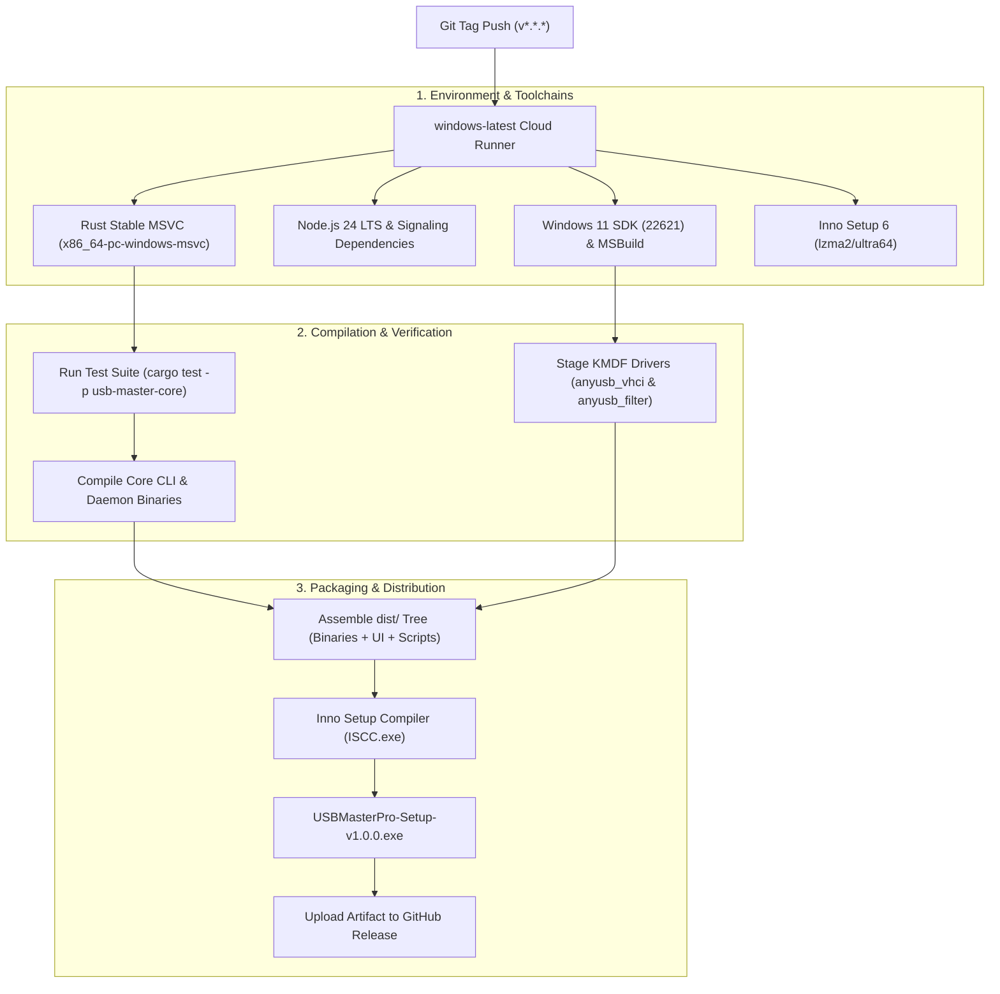

# USB Master Pro — Release & Deployment Runbook

**Document Version**: 1.0.0  
**Classification**: DevOps & Field Operations Playbook  
**Author**: BhartX DevOps & Cloud Engineering Guild (`bhartx-devops`)  
**Target Platform**: Windows 10 & Windows 11 (x64)  
**Distribution Channel**: GitHub Releases & BhartX Enterprise Portal  

---

## 1. Cloud CI/CD Production Pipeline

All production builds of USB Master Pro are compiled and packaged on clean Microsoft-hosted cloud runners via GitHub Actions (`.github/workflows/release-build.yml`). Local development machines are never used to sign or package production binaries.



### 1.1 Pipeline Stages & Commands
1. **Toolchain Initialization**:
   - `dtolnay/rust-toolchain@stable` targeting `x86_64-pc-windows-msvc`.
   - `actions/setup-node@v4` configuring Node.js 24.
   - `microsoft/setup-msbuild@v2` and `GuillaumeFalourd/setup-windows10-sdk-action@v1`.
2. **Automated Test Gate**:
   - Runs `cargo test --release -p usb-master-core`. A single test failure aborts the pipeline.
3. **Binary Compilation**:
   - Compiles release binaries: `cargo build --release --target x86_64-pc-windows-msvc -p usb-master-core`.
4. **Installer Compilation**:
   - Compiles single-file setup wizard using Inno Setup 6:
     ```powershell
     & "C:\Program Files (x86)\Inno Setup 6\ISCC.exe" installer\usb_master_pro.iss
     ```
5. **Artifact Publishing**:
   - Publishes `USBMasterPro-Setup-v1.0.0.exe` and portable binary packages.

---

## 2. Zero-Reboot Dynamic Driver Staging

Legacy USB virtualization tools require a complete Windows restart because they register global class filters and fail to dynamically detach device nodes. USB Master Pro enforces a **Strict Zero-Restart Invariant** during both installation and uninstallation.

```
+----------------------------------------------------------------------------------------------------+
|                                ZERO-REBOOT LIFECYCLE MECHANICS                                     |
+----------------------------------------------------------------------------------------------------+
|                                                                                                    |
|  [ Installation Flow ]                                                                             |
|  1. Pre-flight taskkill to ensure no locked file handles:                                         |
|     taskkill /F /IM USBMasterDaemon.exe /IM USBMasterPro.exe                                       |
|  2. Stage Virtual Host Controller driver dynamically into Driver Store:                            |
|     pnputil.exe /add-driver "drivers\vhci\anyusb_vhci.inf" /install                                |
|  3. Stage Upper Filter Driver dynamically:                                                         |
|     pnputil.exe /add-driver "drivers\filter\anyusb_filter.inf" /install                            |
|  4. Configure native Windows Firewall rules via netsh (Zero PowerShell dependency):                |
|     netsh advfirewall firewall add rule name="USB Master Pro" dir=in action=allow ...              |
|                                                                                                    |
|  [ Clean Uninstallation Flow ]                                                                     |
|  1. Stop active user-mode processes gracefully:                                                    |
|     taskkill /F /IM USBMasterDaemon.exe /IM USBMasterPro.exe                                       |
|  2. Dynamically detach the synthetic Virtual USB Device Node:                                     |
|     pnputil.exe /remove-device "root\anyusb_vhci"                                                  |
|  3. Dynamically unload and delete drivers from Driver Store:                                       |
|     pnputil.exe /delete-driver anyusb_vhci.inf /uninstall /force                                   |
|     pnputil.exe /delete-driver anyusb_filter.inf /uninstall /force                                 |
|  4. Delete firewall rules via netsh. ZERO REBOOT REQUIRED.                                         |
|                                                                                                    |
+----------------------------------------------------------------------------------------------------+
```

---

## 3. Emergency Rollback Playbook

In the rare event of a driver stall, driver signature enforcement issue, or unexpected PnP lockup in field deployments, execute the following emergency recovery procedures.

### 3.1 Field Recovery Script (Run as Administrator)
If a device becomes unresponsive or an upper filter remains attached after an abrupt crash:

```cmd
@echo off
echo [USB Master Pro Emergency Rollback] Terminating all active processes...
taskkill /F /IM USBMasterDaemon.exe >nul 2>&1
taskkill /F /IM USBMasterPro.exe >nul 2>&1

echo [USB Master Pro Emergency Rollback] Detaching Virtual USB Bus...
pnputil.exe /remove-device "root\anyusb_vhci" >nul 2>&1

echo [USB Master Pro Emergency Rollback] Forcing Driver Store Unload...
pnputil.exe /delete-driver anyusb_vhci.inf /uninstall /force >nul 2>&1
pnputil.exe /delete-driver anyusb_filter.inf /uninstall /force >nul 2>&1

echo [USB Master Pro Emergency Rollback] Cleaning Registry UpperFilters...
REM Query and clean any orphaned UpperFilters under physical USB device keys
reg query "HKLM\SYSTEM\CurrentControlSet\Control\Class\{36fc9e60-c465-11cf-8056-444553540000}" /v UpperFilters >nul 2>&1
if %errorLevel% equ 0 (
    echo Cleaning global Class filter key if erroneously present...
    reg delete "HKLM\SYSTEM\CurrentControlSet\Control\Class\{36fc9e60-c465-11cf-8056-444553540000}" /v UpperFilters /f >nul 2>&1
)

echo [USB Master Pro Emergency Rollback] Flushing Windows PnP Bus Relations...
pnputil.exe /scan-devices >nul 2>&1

echo [SUCCESS] Emergency recovery complete. Hardware returned to native OS control.
```

### 3.2 Troubleshooting Matrix

| Symptom | Probable Cause | Immediate Remediation |
| :--- | :--- | :--- |
| **Windows prompts for restart during install** | A running process holds a locked handle on `anyusb_vhci.sys` | Run `taskkill /F /IM USBMasterDaemon.exe` before invoking installer. The installer sets `RestartIfNeededByRun=no`. |
| **Remote device mounted but yellow exclamation in Device Manager** | Missing OEM manufacturer driver on guest PC | Install the official device software (e.g. Mantra RD Service) on the receiving computer. |
| **Driver installation blocked by Windows SmartScreen / SignTool** | Windows Driver Signature Enforcement in Test Mode | Verify WHQL catalog or run `scripts\setup_field_test_signing.ps1` to trust the test root certificate. |
| **Physical USB scanner disconnected but still shows "Shared"** | PnP surprise removal event was delayed | Daemon hotplug monitor re-scans every 2 seconds; click "Refresh Devices" in WebUI or unplug/replug the peripheral. |
