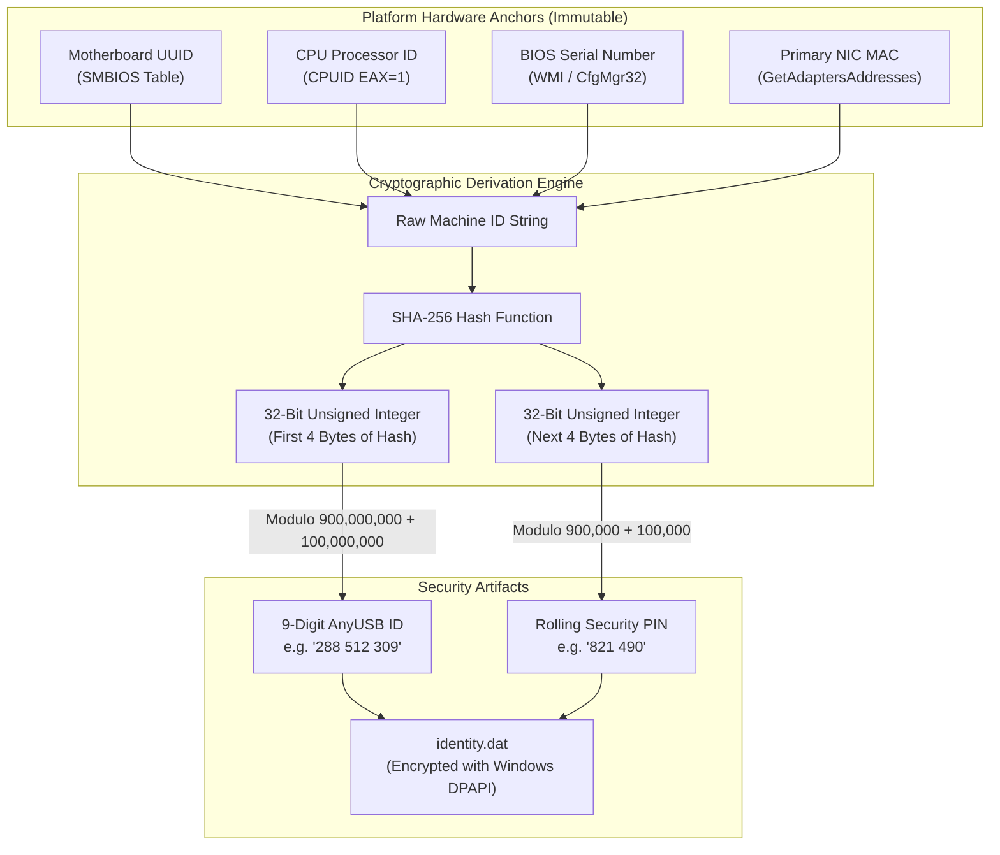

# USB Master Pro — Comprehensive Threat Model & Security Architecture

**Document Version**: 1.0.0  
**Classification**: Security Architecture & Risk Assessment  
**Author**: BhartX Security Engineering & HexStrike Guild  
**Compliance Standards**: UIDAI Aadhaar RD Service 2.0 / PMJAY Ayushman Bharat / OWASP Top 10 / NIST SP 800-53  

---

## 1. Security Architecture Overview & Trust Boundaries

USB Master Pro operates across kernel space, user space, and untrusted network perimeters. Establishing explicit trust boundaries is critical to preventing kernel memory corruption, unauthorized device access, biometric spoofing, and lateral privilege escalation.

```
+--------------------------------------------------------------------------------------------------------+
|                                  TRUST BOUNDARY ARCHITECTURE                                           |
+--------------------------------------------------------------------------------------------------------+
|                                                                                                        |
|  [ TRUST BOUNDARY 1: Hardware & Physical Bus ]                                                         |
|  Physical USB Peripherals <=========================> Kernel USB Core (usbhub.sys)                     |
|                                                                                                        |
|  [ TRUST BOUNDARY 2: Kernel / User Mode Boundary ]                                                     |
|  KMDF Drivers (anyusb_filter.sys / anyusb_vhci.sys) <== IOCTL Dispatch ==> USBMasterPro Core Daemon   |
|                                                                                                        |
|  [ TRUST BOUNDARY 3: Local Inter-Process Boundary ]                                                    |
|  USBMasterPro Core Daemon (127.0.0.1:19842) <======== Local REST/WS =======> UI Desktop Frontend       |
|                                                                                                        |
|  [ TRUST BOUNDARY 4: Public WAN / Signaling Perimeter ]                                                |
|  USBMasterPro Core Daemon <==== Outbound WSS / TLS 443 ====> Cloud Signaling Broker & Rendezvous       |
|                                                                                                        |
|  [ TRUST BOUNDARY 5: P2P Peer Virtualization Perimeter ]                                               |
|  Host Core Daemon <========= WebRTC DataChannel (DTLS 1.3 / AES-256-GCM) =========> Client Core Daemon  |
|                                                                                                        |
+--------------------------------------------------------------------------------------------------------+
```

---

## 2. STRIDE Threat Analysis Matrix

The STRIDE model categorizes security threats across all system components and communication paths.

| Threat Category | Threat ID | Threat Description | Attack Surface | Likelihood | Impact | Mitigating Architectural Control |
| :--- | :--- | :--- | :--- | :--- | :--- | :--- |
| **Spoofing** | TH-S01 | Malicious node assumes another peer's 9-digit AnyUSB ID on the signaling broker | Signaling Broker (WSS) | Medium | High | **Cryptographic Hardware Signature**: Every node registers with a signature derived from a local private key stored in Windows DPAPI, verified against its persistent hardware hash. |
| **Spoofing** | TH-S02 | Rogue local application impersonates user UI on 127.0.0.1:19842 | Local IPC REST API | Medium | High | **Loopback Token & Origin Validation**: Local daemon enforces strict Origin header verification (`http://127.0.0.1:19842`) and validates internal session tokens. |
| **Tampering** | TH-T01 | Attacker intercepts and modifies raw URB packets in transit (e.g. injecting malicious firmware or biometric image) | P2P Network Data Plane | Low | Critical | **End-to-End DTLS 1.3 / AES-256-GCM**: All Turbo-URB packets are encrypted point-to-point. Payloads with failed authentication tags are immediately discarded. |
| **Tampering** | TH-T02 | Malicious user passes oversized or crafted IOCTL buffers to driver | Kernel IOCTL Interface | Low | Critical | **Strict Boundary Buffer Validation**: `anyusb_filter.sys` and `anyusb_vhci.sys` enforce `METHOD_BUFFERED` / `METHOD_DIRECT` validation; user pointers are probed with `ProbeForRead` / `ProbeForWrite` before access. |
| **Repudiation** | TH-R01 | Operator denies sharing or mounting a sensitive peripheral (e.g. YubiKey or banking token) | Core Engine / UI | Medium | Medium | **Cryptographic Audit Ledger**: All connection decisions, device share events, and mount operations are signed and recorded in `%PROGRAMDATA%\USB Master Pro\audit.log`. |
| **Information Disclosure** | TH-I01 | Eavesdropper captures biometric fingerprint platen rasters or Iris scans during RD Service capture | Signaling / Relay Server | Low | Critical | **Zero-Retention Relay & E2E Encryption**: The signaling broker and TURN relays never possess decryption keys. Biometric data is strictly encrypted peer-to-peer. |
| **Information Disclosure** | TH-I02 | Sensitive URB buffer fragments remain in uninitialized kernel or user-space memory after transfer | System RAM | Medium | High | **Deterministic Zeroization**: All slab buffers and driver URB memory structures are scrubbed with `RtlSecureZeroMemory` / `zeroize::Zeroize` immediately upon completion. |
| **Denial of Service** | TH-D01 | Malicious peer floods sender with connection requests, exhausting resources | Signaling Broker / Daemon | High | Medium | **Broker Rate Limiting & Rolling PIN**: Broker enforces a rate limit of 5 requests/min per IP. Incoming requests require a matching 6-digit rolling PIN or interactive user acceptance. |
| **Denial of Service** | TH-D02 | Speculative read ring exhausts kernel non-paged pool memory | Kernel VHCI Driver | Medium | Critical | **Bounded Buffer Pools**: Prefetch ring is strictly hard-capped at 16 buffers (maximum 8 MB total allocation). New requests fail gracefully with `STATUS_INSUFFICIENT_RESOURCES`. |
| **Elevation of Privilege** | TH-E01 | Attacker exploits virtual host controller driver to execute arbitrary kernel-mode code | Kernel Driver (`anyusb_vhci.sys`) | Low | Critical | **KMDF 1.33 Framework Safety**: Driver compiled with `/guard:cf` (Control Flow Guard), `/GS` (Buffer Security Check), and passes Microsoft WHQL driver verification tests. |
| **Elevation of Privilege** | TH-E02 | Remote peer shares a virtual keyboard/mouse to inject malicious keystrokes (BadUSB attack) | Virtual USB Bus | High | Critical | **HID Self-Exclusion Invariant**: HID system devices (`Class 0x03`) are blocked from auto-mounting and require explicit double-confirmation with administrative elevation. |

---

## 3. DREAD Risk Scoring & Quantitative Evaluation

The DREAD scoring model evaluates risks quantitatively on a scale of 1 to 10 across five criteria:
- **D**amage Potential: Severity of damage if exploited.
- **R**eproducibility: Ease of reproducing the attack.
- **E**xploitability: Technical skill required to execute the exploit.
- **A**ffected Users: Percentage of users impacted.
- **D**iscoverability: Ease of discovering the vulnerability.

$$\text{Risk Score} = \frac{D + R + E + A + D_{\text{discover}}}{5}$$

| Threat ID | Threat Vector | D | R | E | A | D | Total Score | Severity Level | Status |
| :--- | :--- | :---: | :---: | :---: | :---: | :---: | :---: | :---: | :--- |
| **TH-T01** | Wire URB Tampering / MITM | 10 | 2 | 2 | 10 | 3 | **5.4** | Medium | **Mitigated** (DTLS 1.3 / AES-256-GCM) |
| **TH-T02** | Kernel Buffer Overflow via IOCTL | 10 | 3 | 3 | 10 | 2 | **5.6** | Medium | **Mitigated** (KMDF Bounded Buffer Checks) |
| **TH-I01** | Biometric Platen Eavesdropping | 10 | 2 | 2 | 10 | 3 | **5.4** | Medium | **Mitigated** (Zero-Retention & E2E Encryption) |
| **TH-I02** | Memory Remanence of Biometric Data | 8 | 4 | 3 | 10 | 4 | **5.8** | Medium | **Mitigated** (Cryptographic Memory Scrubbing) |
| **TH-D01** | Signaling Broker Flooding / Exhaustion | 5 | 8 | 8 | 8 | 8 | **7.4** | High | **Mitigated** (Token Bucket Rate Limiting) |
| **TH-D02** | Kernel Pool Exhaustion via URB Ring | 9 | 4 | 4 | 10 | 3 | **6.0** | High | **Mitigated** (Strict 16-Buffer Slab Ring Cap) |
| **TH-E02** | Remote HID Keystroke Injection (BadUSB) | 10 | 6 | 6 | 8 | 7 | **7.4** | High | **Mitigated** (Strict HID Exclusion Invariant) |

---

## 4. Installation Identity vs. 9-Digit AnyUSB ID

USB Master Pro cleanly separates the internal cryptographic installation identity from the human-readable 9-digit connection ID.



### 4.1 Derivation Mechanics
1. **Hardware Telemetry Gathering**: The engine retrieves immutable motherboard UUID, CPU ID, BIOS serial, and primary MAC address.
2. **Deterministic Hashing**:
   $$\text{HardwareHash} = \text{SHA256}(\text{MachineID} \parallel \text{Hostname} \parallel \text{OS})$$
3. **9-Digit AnyUSB ID Construction**:
   $$\text{RawID} = 100\,000\,000 + (\text{Uint32}(\text{Hash}[0..4]) \pmod{900\,000\,000})$$
   Formatted as `XXX XXX XXX` (e.g. `288 512 309`).
4. **Local Secure Storage**:
   The generated identity parameters are stored in `%PROGRAMDATA%\USB Master Pro\identity.dat` encrypted with Windows DPAPI (`CryptProtectData`), ensuring only the local SYSTEM or authorized administrator context can read the token.

---

## 5. Biometric Payload Privacy & UIDAI Zero-Retention Guarantee

Under UIDAI Aadhaar RD Service 2.0 and Ayushman Bharat (PMJAY) compliance frameworks, storing, caching, or logging unencrypted raw biometric rasters is a criminal violation under the Aadhaar Act. USB Master Pro implements strict cryptographic zero-retention controls:

```
+-----------------------------------------------------------------------------------------------+
|                       BIOMETRIC ZERO-RETENTION LIFECYCLE                                      |
+-----------------------------------------------------------------------------------------------+
|                                                                                               |
|  [ Step 1: Capture in Non-Paged Pool ]                                                         |
|  • Raw 500 DPI biometric frames (Mantra/Morpho) captured directly into Non-Paged Kernel Pool.  |
|  • MmBuildMdlForNonPagedPool prevents the operating system from swapping buffers to disk.     |
|                                                                                               |
|  [ Step 2: In-Memory Compression & Stream Encryption ]                                        |
|  • Raw frame compressed using Zstandard level-1 directly in user-space RAM.                   |
|  • Encrypted into DTLS-SRTP packet payloads with AES-256-GCM.                                 |
|  • ZERO writes to disk, pagefile, or temporary crashdumps.                                    |
|                                                                                               |
|  [ Step 3: Immediate Cryptographic Memory Scrubbing ]                                         |
|  • Immediately after the network packet is sent or the URB completes:                         |
|    - C/Kernel: RtlSecureZeroMemory(Buffer, Length)                                            |
|    - Rust: zeroize::Zeroize::zeroize(&mut buffer)                                             |
|  • Memory compiler optimizations that could elide the scrub (dead-store elimination) blocked. |
|                                                                                               |
|  [ Step 4: Guest Injection & Local RD Service Consumption ]                                   |
|  • Mounted synthetic device satisfies guest RD Service IRPs.                                  |
|  • RD Service encrypts PID block with UIDAI Public Key.                                       |
|  • Virtual Host Controller wipes temporary UPDO buffers immediately.                          |
|                                                                                               |
+-----------------------------------------------------------------------------------------------+
```

### 5.1 Memory Wiping Invariants
1. **No Disk Swapping**: All biometric I/O buffers are locked in physical RAM using `MmProbeAndLockPages` with `IoReadAccess`. Under no circumstance can raw biometric data be written to `pagefile.sys` or `hiberfil.sys`.
2. **Compiler Barrier Zeroization**: Memory scrubbing must use volatile intrinsics or the Rust `zeroize` crate to prevent the optimizing compiler from eliminating the wipe operation as a dead store.
3. **Zero Biometric Logging**: Log output strictly records metadata (e.g., endpoint address, packet size, compression ratio, transfer latency). Logging payload bytes, hex dumps, or minutiae data is compile-time prohibited via release build assertions.
