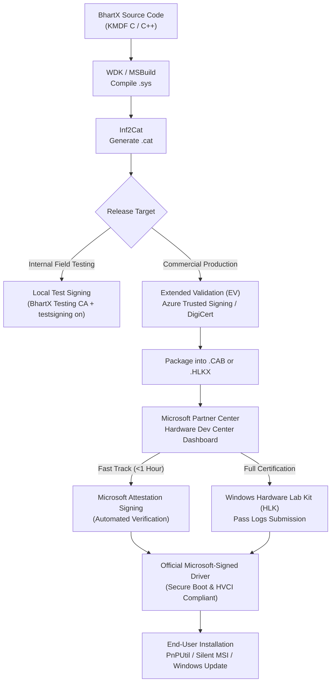

# Microsoft WHQL Compliance & Driver Signing Playbook
**Company:** BhartX Ecosystems Pvt Ltd  
**Product:** USB Master Pro (KMDF Virtual USB Host Controller & Hardware Filter)  
**Target Platforms:** Windows 10 (1809+), Windows 11 (21H2, 22H2, 23H2, 24H2), Windows Server 2019/2022/2025  
**Architectures:** x64 (AMD64), ARM64  
**Classification:** Kernel-Mode Driver Framework (KMDF v1.33)  

---

## 1. Executive Summary & Architecture Overview

Windows 10 and 11 enforce strict **Kernel Mode Code Signing (KMCS)** and **Hypervisor-Protected Code Integrity (HVCI / Memory Integrity)** under Virtualization-based Security (VBS). Kernel drivers cannot run on retail customer systems with UEFI Secure Boot enabled unless they carry an official digital signature issued by the **Microsoft Windows Hardware Compatibility Publisher** CA.

Self-signed certificates or traditional cross-signed certificates (which expired permanently in 2021) will trigger:
* Windows Error Code 52: *"Windows cannot verify the digital signature for the drivers required for this device."*
* Immediate driver load refusal under Secure Boot.

To achieve seamless, warning-free, zero-reboot installation on any Windows 10/11 system worldwide, **BhartX Ecosystems Pvt Ltd** must follow the Microsoft Hardware Submission pipeline outlined in this playbook.



---

## 2. Step 1: Microsoft Partner Center (Sysdev) Enrollment

To submit drivers to Microsoft for digital signature, BhartX Ecosystems Pvt Ltd must maintain an active **Microsoft Partner Center - Hardware Developer Program** account.

### 2.1 Prerequisites Checklist
1. **Legal Business Entity:** BhartX Ecosystems Pvt Ltd registered with the Ministry of Corporate Affairs (MCA), India.
2. **D-U-N-S Number:** Active 9-digit Dun & Bradstreet number registered with the exact legal name:
   * Company Name: `BhartX Ecosystems Pvt Ltd`
   * Address matching legal incorporation documents exactly.
3. **Microsoft Entra ID (Azure AD):** An organization tenant (e.g., `bhartx.com` or `bhartxecosystems.onmicrosoft.com`). Personal Microsoft accounts (`@outlook.com`, `@gmail.com`) are rejected.
4. **Corporate Email Domain:** Work account on the corporate domain (`engineering@bhartx.com`).

### 2.2 Enrollment Steps
1. Navigate to the [Microsoft Partner Center Enrollment](https://partner.microsoft.com/dashboard/registration/hardware).
2. Sign in with the BhartX Entra ID Global Administrator credentials.
3. Select **Hardware Developer Program** (formerly Sysdev).
4. Enter the company DUNS number and corporate contact details.
5. **Identity Vetting:** Microsoft contracts with an external verification vendor (Dun & Bradstreet / LexisNexis) to verify:
   * Certificate of Incorporation (ROC).
   * Authorized representative verification via official business phone number.
   * Domain ownership.
6. **Certificate Binding:** Download the Microsoft sign-in validation file (`SignableFile.bin`), sign it using the company's EV Code Signing Certificate or Azure Trusted Signing identity, and upload it back to Partner Center to bind the cryptographic signing identity to the tenant.
7. Assign roles:
   * `Hardware Submitter`: Permission to create and submit driver packages.
   * `Hardware Administrator`: Permission to manage legal contracts and sign agreements.

---

## 3. Step 2: Extended Validation (EV) Code Signing Architecture

Microsoft requires an **Extended Validation (EV)** certificate to sign all submissions to the Hardware Dev Center. Standard code signing certificates are not accepted.

### 3.1 Signing Provider Comparison

| Feature | Azure Trusted Signing (Recommended) | DigiCert EV Token / HSM |
| :--- | :--- | :--- |
| **Hosting Model** | Cloud-Native FIPS 140-2 Level 3 HSM | Physical USB Token (SafeNet 5110) or Keylocker |
| **CI/CD Integration** | GitHub Actions native runner support | Requires self-hosted runner with hardware dongle |
| **Lost/Stolen Token Risk** | Zero (governed by Entra ID RBAC) | High (physical hardware dependency) |
| **Cost** | ~$10/month (~$120/year) | ~$700 – $1,200/year |
| **Signing Speed** | Automated API call (<2 seconds) | Manual PIN prompt or cloud HSM setup |
| **Microsoft Native Support**| First-class integration in Partner Center | Industry standard |

### 3.2 Recommended Solution: Azure Trusted Signing
BhartX Ecosystems Pvt Ltd should configure **Azure Trusted Signing**:
1. In the Azure Portal, create an **Azure Trusted Signing Account** under the BhartX subscription.
2. Select **Certificate Profile**: `Public Trust`.
3. Complete organization identity verification (BhartX Ecosystems Pvt Ltd).
4. Configure GitHub Actions authentication via Workload Identity Federation (OIDC) or Service Principal with `Signer` role.
5. In CI/CD build scripts, sign binaries using `trusted-signing-action` without any physical tokens.

### 3.3 Signing with `signtool.exe` (SHA-256 + RFC 3161 Timestamp)
When signing driver files (`.sys` and `.cat`), the signature must use SHA-256 and an RFC 3161 compliant timestamp server:

```powershell
signtool.exe sign /v `
    /fd sha256 `
    /tr http://timestamp.digicert.com `
    /td sha256 `
    /sha1 "<EV_CERT_THUMBPRINT>" `
    "C:\Builds\USB-Master-Pro\drivers\vhci\anyusb_vhci.sys"
```

---

## 4. Step 3: Windows Hardware Lab Kit (HLK) Testing Suite

For enterprise deployments or inclusion on the Windows Server Catalog, drivers must pass the **Windows Hardware Lab Kit (HLK)** test harness.

### 4.1 HLK Topology
* **HLK Controller & Studio:** Windows Server 2022 (Standard or Datacenter) domain controller or standalone test server.
* **HLK Test Clients:** Clean installations of Windows 10 x64, Windows 11 x64, and Windows 11 ARM64 joined to the HLK controller.

### 4.2 Applicable Test Playlists for USB Master Pro
Because USB Master Pro provides both a Virtual Host Controller (Bus Driver) and an Upper Filter Driver, the following HLK test categories apply:

1. **Virtual USB Host Controller (`anyusb_vhci.sys`):**
   * `Device.BusController.USB.*`: Validates URB lifecycle, endpoint descriptors, transfer buffer integrity, and bandwidth allocation.
   * `PnP (Plug and Play) Surprise Removal`: Validates that ungraceful disconnects of virtual USB devices do not cause blue-screens (BugCheck `0xFE` or `0x9F`).
   * `Sleep and PnP (System Power Transitions)`: Verifies clean transitions across ACPI states (S0 -> S3 -> S0, S4 Hibernate, and S0ix Modern Standby).
   * `Hypervisor Code Integrity (HVCI) Verification`: Ensures zero executable code pages without execute-disable (`NX`), no text relocations, and proper page table permissions.

2. **Hardware Upper Filter Driver (`anyusb_filter.sys`):**
   * `Device Path Exerciser`: Stresses IOCTL handling with corrupted and boundary-mutated buffers.
   * `Driver Verifier Concurrent Stress`: Runs driver with Special Pool, Deadlock Detection, DMA checking, and Low Resource Simulation active for 24 hours.

### 4.3 Running HLK via PowerShell Automation
```powershell
# Open HLK Studio and create project
# Select target machine pool containing Windows 10/11 client rigs
# Target: AnyUSB Virtual Host Controller
# Schedule Playlist: "Compatibility Playlist for Windows 11"
# Export results package once all tests show Pass (Green)
```

---

## 5. Step 4: Submission Package Creation & Attestation Signing

Microsoft offers two submission pathways. For rapid commercial deployment of virtual bus drivers, **Attestation Signing** is the recommended zero-friction path.

### 5.1 Pathway A: Microsoft Attestation Signing (Fast Track — Under 1 Hour)
Attestation signing is specifically designed for software-only and virtual drivers. Microsoft scans the driver for malware, validates the EV signature, verifies INF syntax, and returns an officially countersigned driver package signed by **Microsoft Windows Hardware Compatibility Publisher**.

#### Step 5.1.1 Prepare Directory Structure
Create a staging folder for the submission package:
```text
C:\DriverSubmission\
├── anyusb_vhci.inf
├── anyusb_vhci.sys
├── anyusb_vhci.cat
├── anyusb_filter.inf
├── anyusb_filter.sys
└── anyusb_filter.cat
```

#### Step 5.1.2 Create DDF File (`submission.ddf`)
Create a Diamond Directive File to build a standard Microsoft cabinet (`.cab`) file:

```ini
; Cabinet Directive File for BhartX USB Master Pro Drivers
.OPTION EXPLICIT
.Set CabinetNameTemplate=USBMasterPro_Drivers_x64_ARM64.cab
.Set DiskDirectory1=C:\DriverSubmission\out
.Set MaxDiskSize=CDROM
.Set Cabinet=ON
.Set Compress=ON

; VHCI Virtual Host Controller
.Set DestinationDir=vhci
C:\DriverSubmission\anyusb_vhci.inf
C:\DriverSubmission\anyusb_vhci.sys
C:\DriverSubmission\anyusb_vhci.cat

; Upper Filter Driver
.Set DestinationDir=filter
C:\DriverSubmission\anyusb_filter.inf
C:\DriverSubmission\anyusb_filter.sys
C:\DriverSubmission\anyusb_filter.cat
```

#### Step 5.1.3 Build and Sign the CAB Package
```cmd
makecab.exe /F C:\DriverSubmission\submission.ddf
signtool.exe sign /v /fd sha256 /tr http://timestamp.digicert.com /td sha256 /sha1 "<EV_CERT_THUMBPRINT>" C:\DriverSubmission\out\USBMasterPro_Drivers_x64_ARM64.cab
```

#### Step 5.1.4 Submit to Microsoft Partner Center
1. Navigate to **Partner Center Dashboard -> Hardware -> Drivers -> Submit new driver**.
2. Enter submission name: `USB Master Pro Virtual Bus & Filter Driver v1.0.0 (BhartX Ecosystems Pvt Ltd)`.
3. Upload `USBMasterPro_Drivers_x64_ARM64.cab`.
4. Select the target OS certifications:
   * `Windows 10, Client editions (x64, ARM64)`
   * `Windows 11, Client editions (x64, ARM64)`
   * `Windows Server 2019 / 2022 / 2025 (x64)`
5. Check: **Perform Attestation Signing**.
6. Click **Submit**.

#### Step 5.1.5 Retrieve Microsoft Signed Driver
Within 15 to 45 minutes, Partner Center status changes to **Approved**:
1. Download the signed driver package (`.zip`).
2. The downloaded package contains newly generated `.cat` files carrying the authentic Microsoft root signature:
   * Signer: `Microsoft Windows Hardware Compatibility Publisher`
   * Root: `Microsoft Root Certificate Authority 2010`
3. These driver files can now be installed on any Windows machine with Secure Boot and Memory Integrity enabled without warnings or reboot prompts.

---

### 5.2 Pathway B: Full WHQL Compatibility Submission (`.hlkx`)
When submitting HLK test passes for official logo certification:
1. In **HLK Studio**, right-click the project -> **Create Package**.
2. Attach any applicable errata filters approved by Microsoft.
3. Sign the `.hlkx` package using the company EV code signing certificate.
4. Upload `.hlkx` directly to Partner Center.
5. Once approved:
   * Driver receives full WHQL certification badge.
   * Listed on Windows Server Catalog (if server tests passed).
   * Eligible for automated distribution via **Windows Update** (optional).

---

## 6. INF File Compliance Standards for WHQL

The driver INF manifests in `drivers/vhci/anyusb_vhci.inf` and `drivers/filter/anyusb_filter.inf` must meet strict Microsoft WHQL requirements:

1. **Provider & Manufacturer Alignment:**
   * `Provider=%ProviderName%` -> `ProviderName = "BhartX Ecosystems Pvt Ltd"`
   * `%MfgName% = AnyUsb_Device,NTamd64,NTarm64` -> `MfgName = "BhartX Ecosystems"`
2. **Class and ClassGUID:**
   * VHCI Driver: `Class=System`, `ClassGUID={4d36e97d-e325-11ce-bfc1-08002be10318}`
   * Filter Driver: `Class=USB`, `ClassGUID={36FC9E60-C465-11CF-8056-444553540000}`
3. **DriverVer Specification:**
   * Must follow format: `MM/DD/YYYY,X.Y.Z.Build`
   * Date must not be in the future beyond Microsoft ingestion limits.
4. **PnpLockDown Directive:**
   * Add `PnpLockdown=1` in the `[Version]` section for modern Windows 11 isolation compliance.

---

## 7. Local Field-Testing Automation (Pre-WHQL)

For rapid QA, customer pilots, and lab testing prior to receiving Microsoft Partner Center signatures, use the automated PowerShell field-testing harness:

```powershell
# Run from Administrator PowerShell console
Set-ExecutionPolicy -Scope Process -ExecutionPolicy Bypass
& ".\scripts\setup_field_test_signing.ps1" -InstallDrivers
```

### What this script automates:
1. Enables `bcdedit /set testsigning on` (requires UEFI Secure Boot disabled on physical test rigs or VMs).
2. Generates the dedicated **BhartX Ecosystems Field Testing CA** (4096-bit RSA, SHA-256, 5-year validity).
3. Injects the CA certificate into:
   * `Cert:\LocalMachine\Root` (Trusted Root Certification Authorities)
   * `Cert:\LocalMachine\TrustedPublisher` (Trusted Publishers)
4. Generates catalog (`.cat`) files via `Inf2Cat.exe` targeting Windows 10 & 11 x64/ARM64.
5. Cryptographically signs `.sys` and `.cat` binaries with SHA-256 and RFC 3161 timestamps.
6. Installs drivers silently via `pnputil.exe /add-driver ... /install`.

---

## 8. Automated CI/CD Cloud Build Pipeline

To eliminate manual compilation overhead and prevent host pollution, driver builds and packaging are executed in GitHub Actions (`.github/workflows/release-build.yml`):

```yaml
- name: Setup Windows 11 SDK & WDK
  uses: GuillaumeFalourd/setup-windows10-sdk-action@v1
  with:
    sdk-version: 22621

- name: Compile KMDF Drivers (x64)
  shell: cmd
  run: |
    call "C:\Program Files\Microsoft Visual Studio\2022\Enterprise\VC\Auxiliary\Build\vcvars64.bat"
    msbuild drivers/vhci/anyusb_vhci.vcxproj /p:Configuration=Release /p:Platform=x64
    msbuild drivers/filter/anyusb_filter.vcxproj /p:Configuration=Release /p:Platform=x64

- name: Azure Trusted Signing (Production Driver Submission Prep)
  if: startsWith(github.ref, 'refs/tags/v')
  uses: azure/trusted-signing-action@v0.4.1
  with:
    azure-tenant-id: ${{ secrets.AZURE_TENANT_ID }}
    azure-client-id: ${{ secrets.AZURE_CLIENT_ID }}
    azure-client-secret: ${{ secrets.AZURE_CLIENT_SECRET }}
    endpoint: 'https://eus.codesigning.azure.net/'
    trusted-signing-account-name: ${{ secrets.AZURE_SIGNING_ACCOUNT }}
    certificate-profile-name: 'BhartXProductionDrivers'
    files: |
      drivers/**/*.sys
      drivers/**/*.cat
```

---

## 9. Verification & Troubleshooting Reference

### Error: Code 52 in Windows Device Manager
* **Cause:** Driver signature is not trusted by the active Kernel Mode Code Integrity (KMCI) policy.
* **Fix (Field Testing):** Run `bcdedit /set testsigning on`, disable Secure Boot in UEFI/BIOS, and run `setup_field_test_signing.ps1`.
* **Fix (Commercial Production):** Complete Microsoft Attestation Signing via Partner Center.

### Error: Inf2Cat "22.9.7: DriverVer set to a date in the future"
* **Cause:** `DriverVer` date in `.inf` is ahead of current UTC time.
* **Fix:** Update `DriverVer` in `anyusb_vhci.inf` and `anyusb_filter.inf` to match current build timestamp.

### Error: HVCI / Memory Integrity Incompatibility
* **Cause:** Driver contains executable code in non-paged memory without execution protection or writable execute sections.
* **Fix:** Compile with `/INTEGRITYCHECK` linker flag and ensure KMDF v1.33+ is targeted.

---

**Playbook Maintained by:** BhartX Ecosystems Pvt Ltd Cloud Build & DevOps Engineering Team  
**Authorized by:** Logos - AI OS / AI CTO Orchestrator
